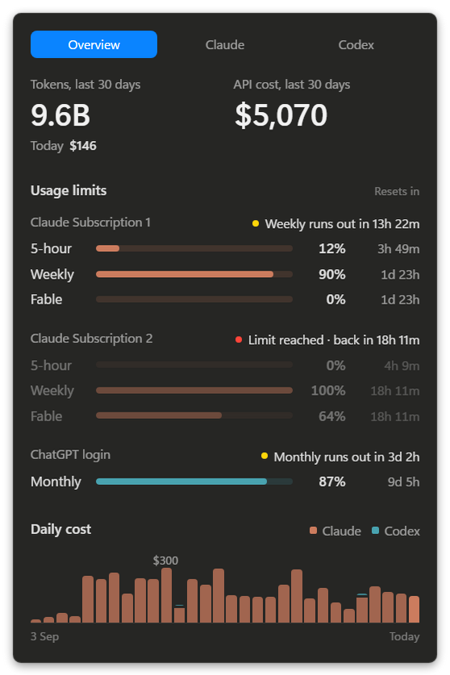

# Agent Meter

Agent Meter is a Windows app that shows your Claude and Codex usage. It shows your usage limits, your tokens and the cost at API prices.

<p align="center"></p>

<p align="center"><sub>Sample data.</sub></p>

## What you see

- The 5-hour, weekly and Fable limits for each Claude subscription.
- The Codex limit.
- The time until each limit resets.
- A warning if you will get to a limit before it resets.
- Your tokens and API cost for the last 30 days.
- Your cost for each day of the last 30 days.

The Agent Meter icon shows your weekly usage as a number. At a limit, the icon is red and shows "!".

## Before you start

You must have:

- Windows 10 or Windows 11.
- [Node.js](https://nodejs.org) 24 or later.
- [Git](https://git-scm.com).
- Claude Code, signed in to your Claude subscription.
- The Codex CLI, if you use Codex.

## Install Agent Meter

1. Open PowerShell.
2. Install Claude Code Usage Monitor. Agent Meter gets the Claude limits from this app.

   ```powershell
   winget install CodeZeno.ClaudeCodeUsageMonitor
   ```

3. Start Claude Code Usage Monitor.

   ```powershell
   claude-code-usage-monitor
   ```

4. Download Agent Meter.

   ```powershell
   git clone https://github.com/azannw/agent-meter.git
   ```

5. Go to the Agent Meter folder.

   ```powershell
   cd agent-meter
   ```

6. Install Agent Meter.

   ```powershell
   npm install
   ```

7. Add Agent Meter to the Start menu.

   ```powershell
   powershell -NoProfile -ExecutionPolicy Bypass -File scripts\install-shortcuts.ps1
   ```

8. Start **Agent Meter** from the Start menu.

You can now see the Agent Meter icon in the notification area of the taskbar.

> **Note:** If you cannot see the icon, click the up arrow (**Show hidden icons**) in the taskbar.

## Use Agent Meter

- To open the panel, click the Agent Meter icon.
- To close the panel, click outside the panel or push **Esc**.

Right-click the Agent Meter icon to open its menu:

- **Refresh now** gets new data immediately.
- **Start with Windows** starts Agent Meter when Windows starts.
- **Quit** stops Agent Meter.

## More than one Claude subscription

Agent Meter shows each Claude subscription that is in Claude Code Usage Monitor. It uses the names from Claude Code Usage Monitor, for example "Claude Subscription 1". To change a name, change it in Claude Code Usage Monitor.

## What Agent Meter reads

Agent Meter reads only files on your computer. It does not read your login files.

- Claude tokens and cost: `%USERPROFILE%\.claude\projects`, and the same folder in each other `.claude-*` folder.
- Codex tokens, cost and limits: `%USERPROFILE%\.codex\sessions`.
- Claude limits: the data file of Claude Code Usage Monitor.

Agent Meter connects to the internet for one thing only: the prices of models that are not Claude models. It gets these prices from the public [LiteLLM](https://github.com/BerriAI/litellm) price list, a maximum of one time each day.

## Remove Agent Meter

1. If **Start with Windows** is on, turn it off in the menu of the Agent Meter icon.
2. Click **Quit** in the menu of the Agent Meter icon.
3. Remove the Start menu shortcut.

   ```powershell
   powershell -NoProfile -ExecutionPolicy Bypass -File scripts\install-shortcuts.ps1 -Remove
   ```

4. Delete the `agent-meter` folder.
